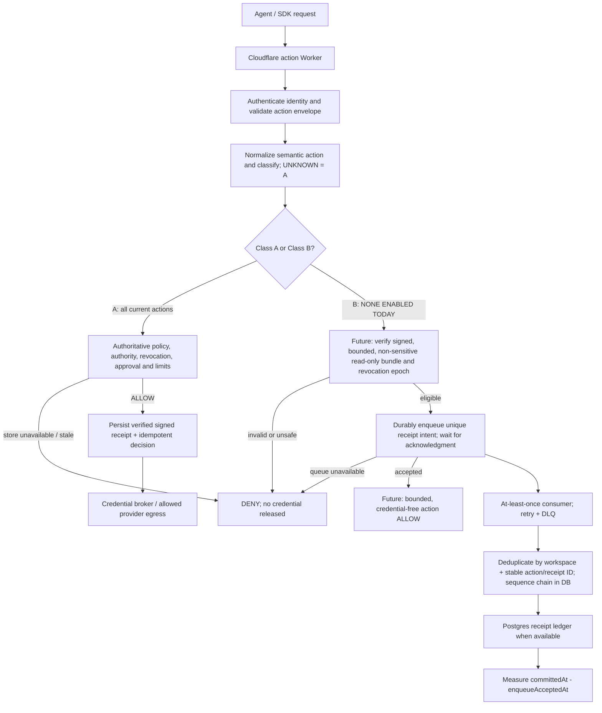

# RaksHex: final action-path architecture and Class A/B classification

> Design status: **target contract only**. No live Class B action path, cached policy bundle, Postgres outage guarantee or receipt-lag SLO is established by this file. The Express app plane (scanning, billing, SSO, gateway, MCP) stays unchanged and is intentionally omitted.

## 1. Architecture comes first

The original Express application plane is deliberately not represented. This is one action's authorization/receipt path, not a complete stack migration.

## 2. Actual action table (derived from `packages/action-control/src/semanticActions.ts`)

**Definitions:** Class A = authoritative security decision and durable signed evidence **before side-effecting egress**; if an upstream dependency prevents either, DENY. Class B = future low-risk, non-credentialed action with explicitly certified resource/read-only behavior, signed bounded cache policy, and **durably accepted** receipt intent before an ALLOW. Class B currently has **zero eligible catalogue entries**; merely tagging `effect: "read"` does not confer eligibility.

| Known semantic action           | Current class                   | Revocation source to check / replicate                                  | Failure mode                                        | Risk note                              |
| ------------------------------- | ------------------------------- | ----------------------------------------------------------------------- | --------------------------------------------------- | -------------------------------------- |
| `financial.refund`              | A                               | Agent/workspace status; authority; policy; credential; financial limits | DENY absent fresh authority and durable receipt     | Money                                  |
| `financial.payment.create`      | A                               | Agent/workspace status; authority; policy; credential; financial limits | DENY absent fresh authority and durable receipt     | Money                                  |
| `financial.subscription.cancel` | A                               | Agent/workspace status; authority; policy; credential; financial limits | DENY absent fresh authority and durable receipt     | Destructive contract change            |
| `code.pr.create`                | A                               | Agent/workspace status; authority; policy; repo permissions             | DENY absent fresh authority and durable receipt     | Write                                  |
| `code.merge`                    | A                               | Agent/workspace status; authority; policy; repo permissions             | DENY absent fresh authority and durable receipt     | Destructive                            |
| `code.branch.delete`            | A                               | Agent/workspace status; authority; policy; repo permissions             | DENY absent fresh authority and durable receipt     | Destructive                            |
| `code.deploy`                   | A                               | Agent/workspace status; authority; policy; deployment permissions       | DENY absent fresh authority and durable receipt     | Production impact                      |
| `database.read`                 | **A (future B candidate only)** | Agent/workspace status; authority; policy; tenant/data permissions      | DENY absent fresh authority and durable receipt     | Secrets/PII; SQL may have side effects |
| `database.write`                | A                               | Agent/workspace status; authority; policy; tenant/data permissions      | DENY absent fresh authority and durable receipt     | Write                                  |
| `database.delete`               | A                               | Agent/workspace status; authority; policy; tenant/data permissions      | DENY absent fresh authority and durable receipt     | Destructive                            |
| `database.schema.change`        | A                               | Agent/workspace status; authority; policy; tenant/data permissions      | DENY absent fresh authority and durable receipt     | Destructive                            |
| `semantic.unknown` (fallback)   | **A**                           | No trustworthy metadata; authoritative verification required            | DENY unless validated as a known, authorized action | Unclassified/mismatch                  |

These are **target revocation inputs**, not proof that every adapter can deliver an instantaneous revocation signal. Future signed Class B bundles must explicitly define maximum staleness, expiration, version/epoch and an emergency revocation channel; TTL alone cannot guarantee immediate revocation.

Code inventory: `packages/action-control/src/actionClasses.ts`. Coverage/regression tests: `packages/action-control/src/actionClasses.test.ts`. Neither is connected to live action routing; intentionally no security guarantee has changed.

## 3. Request flow

1. Authenticate agent; verify workspace, request ID, request payload, idempotency key, and policy version.
2. Normalize the action; reject ambiguity. Unknown, new, side-effecting and insufficiently classified operations go to A.
3. A: require fresh authoritative authority/policy/revocation/approval checks, persist the signed authorization decision and ledger receipt, then allow brokered egress **only** for exact approved action, provider, scope and expiry. If any prerequisite fails, do not release credentials.
4. B (future only): verify action/resource is on an explicitly signed safe read-only allowlist; check bundle validity, revocation epoch and policy scope; atomically or reliably acknowledge a durable receipt intent before returning ALLOW. No credentials, financial mutation or sensitive data access.
5. Consumer: eventually process Class B receipt intents using at-least-once semantics; enforce uniqueness in persistent storage. Chain order must be assigned by a database-side sequencer / single-writer transaction, not assumed from queue delivery.
6. Trace each decision and receipt with the same action ID and times: request started, decision returned, enqueue accepted, receipt committed.

A queue acknowledgment is a **durably accepted intent**, **not yet a final signed receipt**. To claim stronger non-repudiation on B before egress, the receipt must itself be signed and durably persisted **before** ALLOW.

## 4. Failure behavior: desired vs verified

| Failure                    | Target requirement                                                                                                                                                                               | What is proven right now                                                                        |
| -------------------------- | ------------------------------------------------------------------------------------------------------------------------------------------------------------------------------------------------ | ----------------------------------------------------------------------------------------------- |
| Postgres down              | A denies; explicitly safe B can use valid cache only with queue-accepted receipt intent                                                                                                          | Existing `agentFirewall.evaluate` is Postgres-dependent; independent Class B is not wired       |
| Control plane down         | A denies when fresh auth unavailable. B only uses a signed in-TTL bundle. After TTL, a separate hard-coded, reviewed fail-open B scope may be used **only with durable logging**; otherwise DENY | Signed policy bundle revocation & B path not proven                                             |
| Queue unavailable          | Never return B ALLOW without durable intent; A synchronous receipt path allowed only if real database and signing dependencies work, else DENY                                                   | Requires a fault-injection test                                                                 |
| Unclassified / conflicting | Class A (default); unknown writes denied/approval-gated by existing engine                                                                                                                       | Source treats unknown writes restrictively in enforce mode; classification metadata is proposed |
| Postgres restored          | Replay buffered intent idempotently; sequence hash-chain updates under lock; measure lag/backlog                                                                                                 | Cloudflare Queues is not FIFO; reorder/duplicate deliveries must be handled by consumer         |
| Stale or revoked B bundle  | Forbid secrets, writes, sensitive reads and side effects; reject if signature/version/epoch or TTL invalid                                                                                       | No Class B bundle authorization yet                                                             |

**Do not label the first three cases `[Certain]` until outage tests and telemetry prove them.**

Current code note: `normalizeSemanticAction` uses regexes; e.g. `WITH deleted AS (DELETE ... RETURNING ...) SELECT ...` may map to `database.read`. This is why `database.read` remains A and why an eventual B must be structurally attested as non-mutating and non-sensitive, rather than trusted by regex.

## 5. Controlled kill-Postgres test (staging only)

**Execution status: NOT RUN.** A real outage test requires an isolated staging Postgres instance, API, receipt signing keys, queue, an operational Class B implementation and observable timestamps. Do not stop the production database or the unrelated DecisionTrace Railway database.

1. Create an isolated, disposable dataset in staging; confirm backup/restore; prepare seeded workspace, valid/revoked authority, policy, test keys, A actions and *separately verified future* B fixtures.
2. Run an end-to-end A allow and deny; verify signed receipt is persisted before any provider side effect, and no credential is released for DENY.
3. Establish healthy baseline with representative concurrency, recorded environment, and warm-up. Instrument request start, decision response, queue enqueue acknowledgment, persistent receipt commit, idempotency dedupe, and per-workspace chain sequence.
4. Stop **staging Postgres only** for a controlled interval. Replay A and B fixtures while holding queue healthy. Assert A is never ALLOW; assert **only certified** B operations continue; ensure each B ALLOW has a durable accepted receipt intent. If there are no certified B actions, this test should show A denies and **zero** B ALLOW.
5. Restore staging Postgres. Drain queue; verify unique `(workspaceId, actionId)`, eventual receipt completeness, signed hash-chain continuity, correct allowed-receipt linkage and no missing/extra side effects. Assume queue delivery can reorder.
6. Separately kill control plane, expire/roll revocation bundle, disconnect queue, replay duplicates, and test invalid signatures. Every unsafe branch should fail closed.
7. Record raw per-request samples, any error, and queue/DB telemetry. Reject release if lost evidence, incorrect authorization, privilege bypass, chain corruption, unreconciled DLQ or unexpected duplicate side effect.

### Metrics, not invented latency claims

- **Decision p99** = 99th percentile of `decisionResponseAt - requestStartAt`, split by A/B, normal/outage/recovery and ALLOW/DENY.
- **Receipt lag p99** = 99th percentile of `receiptCommittedAt - enqueueAcceptedAt` for each B intent. Also report max lag and pending/uncommitted intents.
- **Receipt completeness** = distinct persistently committed action IDs / distinct accepted action IDs, including DLQ reconciliation.
- **Ordering correctness** = hash-chain verification and per-workspace monotonic assigned sequence; never infer FIFO from message order.
- **Safety** = zero unauthorized ALLOW, zero unreceipted A egress, zero B ALLOW without durably accepted intent, zero credential release after DENY.
- Report sample count, test duration, load, region, provisioned resources, failure injection times, and raw histograms; do not quote p99 until these are measured.

### Stage gates

- Gate 1 — Review all 11 classifications and unknown fallback with security owner; unit tests green.
- Gate 2 — Implement signed/versioned cache bundle + revocation stream and **explicit** B eligibility, without allowing raw `database.read` to qualify.
- Gate 3 — Implement Queue-accepted intent + receipt reconciliation and ordered ledger append/idempotency; prove loss/duplicate behavior.
- Gate 4 — Run outage/chaos tests and publish p50/p95/p99 and receipt lag with test evidence.
- Gate 5 — Canary rollout with rollback; no production traffic switch until all proofs are green.

## References inside repo

- `packages/action-control/src/semanticActions.ts` — canonical list of known actions / regex normalization.
- `packages/action-control/src/evaluate.ts` — delegated authority and policy checks.
- `apps/api/api/agentFirewall.ts` — Postgres-dependent authoritative evaluation and Action Ledger.
- `apps/api/services/credentialBroker.ts` — enforced broker path and origin/replay restrictions.
- `docs/SIGNED_ACTION_RECEIPTS.md` — signed receipt guarantees on the existing Postgres path.
- `docs/cloudflare/CF02_LIVE_STATUS.md` — Cloudflare staging partial deployment, not production parity.
- Cloudflare official: https://developers.cloudflare.com/queues/reference/delivery-guarantees/ and https://developers.cloudflare.com/queues/reference/how-queues-works/ — at least once, not guaranteed FIFO.
